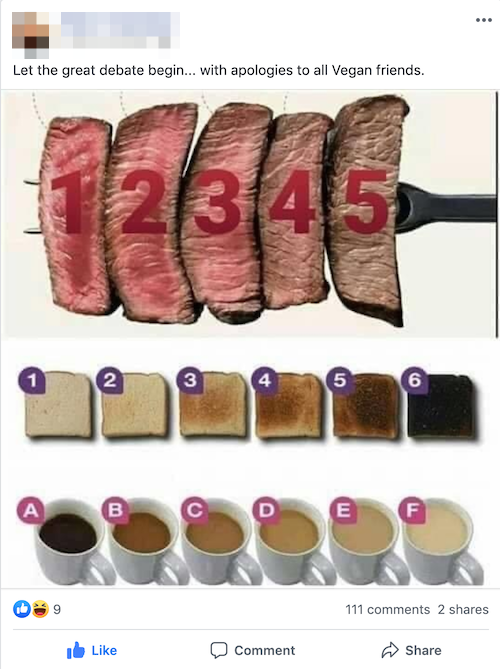

# Red to Green: Python problems from FizzBuzz to mixture models

## Introduction

Welcome! This is a hands-on collection of Python exercises that begin *red* and
end *green*. Most functions start as stubs whose tests fail, and your job is to
turn them green by implementing them one small step at a time. The problems run
from FizzBuzz-sized programming puzzles to data analysis and statistical
modelling. If you complete all the exercises you'll have touched on Python
fundamentals such as list comprehensions, generators and object orientation, but
also maximum likelihood, expectation-maximisation, recursion, test first
development, refactoring, graph search and even cellular automaton.

Start with Python Fundamentals, then choose one of the routes below or jump to a
topic that interests you. The early exercises are bite-sized; later notebooks,
the kata, and mixture-model work can each take several sessions.

Look out for these markers: 💡 a hint (usually in a footnote), 😱 a
particularly challenging section, and 🚀 an optional extension.

> [!IMPORTANT]
> The purpose of this package is partially to help you learn Python, but is also a
> collection of interesting and hopefully satisfying problems to solve. It is not
> simply about collecting completed solutions. A coding agent could complete the
> exercises for you, but that would bypass the practice and interest they are
> designed to provide. Writing code, investigating failures, and explaining your
> choices build an understanding of Python that remains useful in the age of
> agentic coding: you need that understanding to specify requirements, assess
> generated code, spot mistakes, and maintain the result. Agents can support your
> learning with hints, explanations, or reviews of your own attempts. Try each
> problem yourself first, and make sure you can explain and test any code you
> adopt; passing tests alone is not the learning goal.

As a rough guide, allow 25 to 50 hours for a full pass, depending on your
experience and how deeply you explore the investigations. Treat that as a
provisional guide, not a deadline: you do not need to do everything, and each
route below finishes at a sensible stopping point. For an overview of the
repository layout and development setup, see [DEVELOPMENT.md](DEVELOPMENT.md).

The dev container is ready to use. For a local setup with the notebooks and
scientific tools, install the complete environment with:

```bash
uv sync --all-groups --extra science
```

Most exercise functions start as stubs, so their tests are red until you
implement them. Pick an exercise, read its prompt, and run its focused test
command; make one small change at a time and rerun the test until it turns
green. Notebook analyses have no pass or fail, so they are checked by your own
plots and explanations. For your first check, try
`uv run pytest tests/test_language.py`. The early language exercises use only
the Python standard library; scientific exercises need the optional science
packages installed above.

## Choosing a route

Each route has its own test commands, and finishing one counts as completing a
useful course. The exercises that follow are in the order of the sections below,
not the order of the routes.

**Route 1: Python core.** Learn the language and practise writing tested code.

1. Python Fundamentals, Q1 to Q7:
   `uv run pytest tests/test_language.py tests/test_sudoku.py -q`
2. Object-oriented Python, from noisy animals to the parrot:
   `uv run pytest tests/test_oop.py -q`
3. One kata from Refactoring and Test-First Development, either Gilded Rose
   (`tests/test_gilded_rose.py`) or 99 Bottles (`tests/test_bottles.py`). The
   other is optional.
4. Word ladder: `uv run pytest tests/test_word_ladder.py -q`

**Route 2: Scientific Python.** Work with real data. Do Route 1 first, then:

1. Data Analysis Q1, Mysterious data.
2. Scientific Python Q1, Q2 and Q4 (standard error, least squares and the
   bootstrap): `uv run pytest tests/test_statistics.py -k "standard_error or ols"`
3. Data Analysis Q2 (Steak, Tea, and Toast) and Q3 (Old Faithful regression).
4. Optionally, Models of Life: Game of Life and Dawkins' weasel.

**Route 3: Advanced extensions.** Choose what interests you. The algorithm
projects (Try, try again, Sudoku solver, global sequence alignment) need only
Route 1. The
modelling projects (Scientific Python Q3 and Q5, and Statistical Modelling)
need Route 2, and some comfort with probability densities, likelihood, logs,
basic linear algebra and covariance matrices.

## Python Fundamentals

> **Prerequisites:** none.
>
> **You’ll practise:** functions, sequences, comprehensions, iteration,
> dictionaries, generators, exceptions, and readable tests.
>
> **Check:** `uv run pytest tests/test_language.py tests/test_sudoku.py -q`, or
> each question's own command below.

### Q1. Exponentiation

Write a function to take numbers $x$ and return $e^x$ as `exponentiate(values)`
in `src/pyproblems/language.py`. Note that the input can be any iterable, not
just a list.

Begin with a `for` loop and `list.append`. Once it works, try rewriting the
function as a list comprehension. Compare the two versions for readability.

Check this exercise with:

```bash
uv run pytest tests/test_language.py -k exponentiate
```

### Q2. Adjacent products

Given a sequence of integers, write a function to find the pair of adjacent
elements that has the largest product and return that product. Return `None`
when fewer than two values are supplied. The input may be any iterable.

For example, for the list `[3, 6, -2, -5, 7, 3]` you should return `21`, since
7 and 3 produce the largest product.

Implement `adjacent_elements_product(values)` in `language.py`.

💡 **Hint:** `itertools.pairwise` could be useful here.

```bash
uv run pytest tests/test_language.py -k adjacent
```

### Q3. FizzBuzz

FizzBuzz is a classic programming exercise. The goal is to count through the
integers, replacing multiples of three with `Fizz`, multiples of five with
`Buzz`, and multiples of both with `FizzBuzz`.

Implement `fizzbuzz(n)` to return strings from 1 through `n`, inclusive. For
example, `fizzbuzz(5)` should return `['1', '2', 'Fizz', '4', 'Buzz']`.

```bash
uv run pytest tests/test_language.py -k fizzbuzz
```

### Q4. Fibonacci sequence

The Fibonacci sequence starts as 0, 1, 1, 2, 3, 5. After the starting values
0 and 1, each new value is the sum of the two before it.

Implement `fibonacci()` as a generator that yields the Fibonacci sequence
indefinitely. Each call to `fibonacci()` should return an independent iterator.
Try `next()` to request individual values and `itertools.islice` to take a
finite prefix without materialising the infinite sequence.

```python
from itertools import islice

list(islice(fibonacci(), 8))
```

```bash
uv run pytest tests/test_language.py -k fibonacci
```

### Q5. First non-repeating character

Given a string, find and return the first instance of a non-repeating character
in it. If there is no such character, return `_`.

For example, in `abacabad`, both `c` and `d` occur once, but `c` comes first;
in `abacabaabacaba`, every character repeats. The search is case-sensitive;
spaces and punctuation count too.

Implement `first_non_repeating_character(text)`.

```bash
uv run pytest tests/test_language.py -k non_repeating
```

### Q6. Python gotchas

These short examples expose behaviour that can be surprising when translating
habits from other languages or when reading unfamiliar Python. Before running
each snippet, write down its output and explain the mechanism. Then write a
correct version as a function in `language.py`, where the tests check that the
intended behaviour holds.

```bash
uv run pytest tests/test_language.py -k gotcha
```

#### a. A mutable default argument

```python
def add_tag(tag, tags=[]):
    tags.append(tag)
    return tags


print(add_tag("first"))
print(add_tag("second"))
```

Implement `add_tag(tag, tags=None)`, which appends `tag` to `tags` and returns
the list. When no list is given it should start a new one, so separate calls
never share state.

#### b. Equality and identity

```python
first = ["tea"]
second = ["tea"]
print(first == second)
print(first is second)
```

Implement `copy_grid(grid)`, which returns a grid that is *equal* to a list of
lists but is not the same object, and shares none of its inner lists with the
original, so changing the copy never changes the original.

#### c. Aliasing through list multiplication

```python
rows = [[]] * 3
rows[0].append("changed")
print(rows)
```

Implement `make_grid(rows, columns, fill=0)`, which returns a list of `rows`
independent lists, each holding `columns` copies of `fill`.

#### d. Mutating a list while iterating

The goal is to keep only the odd values.

```python
values = [1, 2, 4, 6, 7]
for value in values:
    if value % 2 == 0:
        values.remove(value)
print(values)
```

Implement `keep_odd(values)`, which returns a *new* list of the odd values and
leaves its input unchanged.

#### e. Floating-point representation

```python
print(0.1 + 0.2 == 0.3)
```

Implement `approximately_equal(first, second)`, which treats numbers that differ
only by floating-point rounding as equal. 💡 `math.isclose` is worth a look.

#### f. An exhausted iterator

```python
numbers = iter([1, 2, 3])
print(list(numbers))
print(list(numbers))
```

Implement `average(values)`, which returns the mean of any iterable of numbers,
including a one-shot iterator or generator that can only be read once.

### Q7. Sudoku checker

Sudoku asks you to fill a 9 by 9 grid so each row, column, and 3 by 3 box
contains the digits 1 through 9 exactly once. A partially filled grid is
*valid* when none of its supplied digits conflicts with those rules.

Implement `sudoku_checker(grid)` in [sudoku.py](src/pyproblems/sudoku.py).
The input is a list of nine rows containing integers 1 through 9 or `None` for
blanks.

Compare the result with the labelled puzzles from `load_sudoku_data()` and try
an empty grid, a valid completed grid, and a duplicate in each kind of
constraint group.

```bash
uv run pytest tests/test_sudoku.py -q
```

## Object-oriented Python

> **Prerequisites:** Python Fundamentals.
>
> **You’ll practise:** classes, instances, inheritance, method overriding,
> inherited behaviour, and readable object representations.
>
> **Check:** `uv run pytest tests/test_oop.py -q`

### Noisy animals 📣

Create an `Animal` base class in `src/pyproblems/oop.py`. Its initialiser
should store an optional name on the instance, so that `animal.name` returns
it (or `None` if none was given). Its `speak()` method defines the interface
and raises `NotImplementedError`; subclasses provide their own sound by
overriding that method.

Implement an inherited `lyric()` method that calls `self.speak()`
and formats a line such as `Dog goes "woof"`. Because this method calls the
overridden method, the same inherited code works for every subclass. This is
polymorphism: the renderer asks each object to perform the same operation
without branching on its concrete type.

Implement `Dog`, `Cat` and `Bird`. The seven other animals (`Mouse`, `Cow`,
`Frog`, `Elephant`, `Duck`, `Fish` and `Seal`) are already written, so you can
see what a finished subclass looks like. Each class inherits from `Animal` and
implements `speak()`. For example:

```python
dog = Dog("Woofy Goldberg")
print(dog.speak())
print(dog.lyric())
print(dog.name)
print(isinstance(dog, Animal))

animals = [Dog("Woofy Goldberg"), Cat("Chairman Meow"), Fish("Gill Bates")]
print(", ".join(x.name for x in animals))
```

The sound each animal makes is listed in the tests: read
`test_animal_subclasses_override_speak` in [test_oop.py](tests/test_oop.py) to
see what `speak()` should return for `Dog`, `Cat` and `Bird`.

Implement `__str__()` so `str(Dog("Woofy Goldberg"))` produces
`Dog named Woofy Goldberg`, and `str(Cat())` (no name) is just `Cat`. Notice
what is shared and what is not: the sound and the class name belong to the
class, so every `Dog` goes "woof", but the name belongs to each instance, so two
`Dog` objects can have different names. `lyric()` uses the class name, not the
instance name.

### What Does the Fox Say? 🦊

Add a `Fox` class. Its `speak()` should return
`"Ring-ding-ding-ding-dingeringeding!"`. The fox's verse is more than a
`goes` line, so give `Fox` its own `lyric()` method that returns:

```text
But there's one sound
That no one knows
What does the fox say?
"Ring-ding-ding-ding-dingeringeding!"
```

Now create one instance of each of the ten animals above (not the fox) in a
list, in that order. Then implement `wdtfs(animals)`, which takes any
collection of animals, combines their `lyric()` lines with a `Fox`'s `lyric()`
and returns the result as a string: one line per lyric line, ending with a
newline. You should now have the lyrics to
[The Fox (What Does the Fox Say?)](https://www.youtube.com/watch?v=jofNR_WkoCE).
The complete expected song is in
[animal_song_full.txt](tests/fixtures/animal_song_full.txt).

You should notice that the `wdtfs` function does not need to ask what type each
animal is. It calls the same method on every object and lets the object's class
return the lyric line appropriate for that animal. This is polymorphism through
ordinary inheritance and method overriding.

### A parrot that learns 🦜

So far each subclass only returns a fixed string. Subclasses become more
interesting when they have state. Add `Parrot(Bird)`, which repeats the last
sound it heard:

```python
polly = Parrot("Polly Morphism")
print(polly.speak())  # tweet
polly.hear("hello")
print(polly.speak())  # hello
print(polly.lyric())  # Parrot goes "hello"
```

Before it hears anything, a `Parrot` should behave like any other `Bird`, so
use `super()` rather than repeating `"tweet"`. You should not need to change
`lyric()`: it calls `self.speak()`, so it works for the parrot unchanged. A
lookup table of sounds could not do this.

## Refactoring and Test-First Development

### The Gilded Rose Kata 🌹

> **Prerequisites:** Python Fundamentals and Object-oriented Python.
>
> **You’ll practise:** refactoring existing code safely, using tests as a
> specification, and adding a feature to code you did not write.
>
> **Check:** `uv run pytest tests/test_gilded_rose.py -q`

Below you'll find instructions for a "code kata". The job here is to implement a
new request in existing code. Handily, tests already exist that test the
functionality of the existing code, three of which fail (corresponding to the
new request that is not yet implemented). The existing tests are a good, though
not exhaustive, description of the behaviour to preserve: if they pass, you can
be fairly confident that your refactoring has not changed it. Unfortunately for
you, the current implementation of
`update_quality` in [gilded_rose.py](src/pyproblems/gilded_rose.py) is deeply
nested and difficult to modify so you will need to refactor it first.

The setting is an inn that updates each item's `sell_in` countdown and `quality`
once per day. Ordinary goods lose quality faster after their sell-by date; Aged
Brie improves with age; Sulfuras never changes; and backstage passes become more
valuable as a concert approaches, then become worthless afterward. Quality is
generally bounded between 0 and 50, except Sulfuras, whose legendary quality is
left unchanged.

Run the focused tests and read the implementation before refactoring. The
regular-item, Aged Brie, Sulfuras, backstage-pass, quality-bound, and
multiple-item tests characterise existing behaviour. The new requirement is to
implement a new item: "Conjured Mana Cake" that degrades twice as fast as an
ordinary item, including the faster post-expiration rate.

Refactor in small steps, running the focused tests after each change. Refactor
first to make it easy to add the new requirement. Keep the public data model as
a mutable `Item` dataclass and the `update_quality(items)` interface. You may
choose helpers, subclasses, or another design; the tests check behaviour rather
than a particular hierarchy.

The original instructions for this kata are provided in the source code.

### 99 Bottles

> **Prerequisites:** Python Fundamentals.
>
> **You’ll practise:** test-first development, string formatting, composing
> small functions, and writing your own tests.
>
> **Check:** `uv run pytest tests/test_bottles.py -q`

The goal here is to write functions that generate the lyrics to "99 bottles".
We will do this following the principle of test-first development. The tests
for the functions are all provided; you now need to make them pass by filling
in the functions.

Implement `verse(number)`, `verses(start, end)`, and `bottles()` in
[bottles.py](src/pyproblems/bottles.py). The tests in
[test_bottles.py](tests/test_bottles.py) are executable examples: make one
scenario pass at a time, then refactor without changing the lyrics. Preserve
singular and plural grammar, the zero-bottle wording, blank lines between
verses, and the final newline. The full song is available at
[99_bottles.txt](tests/fixtures/99_bottles.txt).

The exercise is deliberately test-first rather than a specification to solve
all at once. Start with one verse, then a range of verses, then the complete
song. Keep formatting decisions at the boundary where they belong: `verse`
creates one stanza, while `verses` and `bottles` compose those stanzas.

**Extension 🚀: write your own tests.** So far the tests have been written for you.
In this extension you write them to add a new requirement. You should write
tests that would actually catch a wrong implementation. No tests are supplied
for it, so yours are the check.

The new requirement is a six-pack. Extend `verse`, `verses`, and `bottles` to
accept a keyword-only `six_packs=False`. When it is `True`, a count of exactly
6 is called "1 six-pack" wherever it appears. Every other count, and the
default behaviour, stays the same. For example, `verse(7, six_packs=True)` and
`verse(6, six_packs=True)` are:

```text
7 bottles of beer on the wall, 7 bottles of beer.
Take one down and pass it around, 1 six-pack of beer on the wall.

1 six-pack of beer on the wall, 1 six-pack of beer.
Take one down and pass it around, 5 bottles of beer on the wall.
```

1. Before changing any code, add tests to
   [test_bottles.py](tests/test_bottles.py) for the two verses above, for a
   verse the option should not affect, for the default lyrics of `verse(6)`,
   and for `verses` passing the option through.
2. Run them and confirm they fail for the right reason (the option does not
   exist yet), not because of a mistake in the test.
3. Make them pass, then refactor with every test still green. If you are
   adding the same `if` in several places, put the wording of a count in one
   place.
4. Check your tests. Break your implementation on purpose, for example by
   treating 5 as a six-pack or by changing only the first half of the verse,
   and confirm that at least one test fails each time. A test that cannot fail
   tells you nothing.

## Scientific Python 🔬

> **Prerequisites:** Python Fundamentals and Object-oriented Python, and the
> optional scientific stack (`uv sync --all-groups --extra science`).
>
> **You’ll practise:** NumPy and SciPy, sampling variation and standard errors,
> least squares, the bootstrap, and likelihood-based estimation.
>
> **Check:** `uv run pytest tests/test_statistics.py -q`

These exercises move from sampling variation, through linear models and
resampling, to likelihood-based estimation.

The reusable calculations are stub functions in
[statistics.py](src/pyproblems/statistics.py) that you complete; their tests
check them. You will use the functions in two notebooks:

- The [Old Faithful notebook](analysis/old_faithful.ipynb) applies them to a
  real dataset.
- The [simulation studies notebook](analysis/simulation_studies.ipynb) uses
  simulated data with known parameters, so you can check what the methods do.

### Q1. Sampling variation and standard error

The standard error (SE) of a statistic is its standard deviation across
repeated samples: how much it would vary if we could redraw the data. For the
sample mean $\bar{x}$ we could, in principle, draw many samples, compute
$\bar{x}$ for each and take the standard deviation of those means. In practice
we have only one sample, so that spread cannot be observed directly.

For the standard error of the mean, theory provides a shortcut: if the
observations are independent with true standard deviation $\sigma$, the SE is
$\sigma/\sqrt{n}$. We rarely know $\sigma$, but can estimate SE by replacing
it with $s$, the standard deviation of the sample we actually have (using $n-1$
in the denominator): $\widehat{\mathrm{SE}}(\bar{x}) = s / \sqrt{n}$.

Implement `standard_error` using $s$ in
[statistics.py](src/pyproblems/statistics.py).  

Old Faithful is a geyser in Yellowstone National Park. Data on eruption waiting
times is a commonly used dataset for statistics. In the [Old Faithful
notebook](analysis/old_faithful.ipynb), report the mean waiting time between
eruptions with its standard error. 

Then, in the [simulation studies notebook](analysis/simulation_studies.ipynb),
simulate 500 independent samples of standard normal data ($\sigma=1$) for each
$n$ from 2 through 100. The true SE is then $1/\sqrt{n}$. Plot the mean of the
estimated standard errors against $n$ and compare it with true SE
($1/\sqrt{n}$); explain the sampling variation and bias you see.

💡 Hint in the footnote [^se-bias].

[^se-bias]: Each estimate $s/\sqrt{n}$ is random because $s$ changes from sample
    to sample, which is the sampling variation. However, there is also a small
    systematic gap. The sample variance $s^2$ averages exactly $\sigma^2$ (it is
    unbiased), but taking a square root bends the average downwards, so $s$
    averages slightly less than $\sigma$ (this is an instance of [Jensen's
    inequality](https://en.wikipedia.org/wiki/Jensen%27s_inequality)). The
    effect is noticeable for small $n$: at $n=2$ the average estimate is about
    0.564, not 0.707. Running more repetitions smooths the random variation but
    does not remove this gap.

### Q2. Linear models and ordinary least squares

Ordinary least squares chooses coefficients that minimise the sum of
squared residuals. For a full-column-rank design matrix $X$ and outcome
vector $y$, the normal equations are $X^\mathsf{T}X\hat{\beta}=X^\mathsf{T}y$.

Implement `ols_coefficients` in [statistics.py](src/pyproblems/statistics.py) by
solving this system with `numpy.linalg.solve`, not by explicitly computing an
inverse. The function does not add an intercept: include a column of ones when
one is wanted. 

In the [simulation studies notebook](analysis/simulation_studies.ipynb),
simulate outcomes from known coefficients and compare your estimates with the
truth and with `numpy.linalg.lstsq`. You will use `ols_coefficients` on real
data later.

### Q3. The binomial and normal distributions

If $X\sim\mathrm{Binomial}(n,p)$, its mean is $np$ and its variance is
$np(1-p)$. When both expected counts $np$ and $n(1-p)$ are sufficiently
large, a normal distribution with that mean and variance can approximate
the binomial. Start with $n=100$ and $p=0.5$.

In the [simulation studies notebook](analysis/simulation_studies.ipynb), use
`scipy.stats` to plot the exact probability at each integer from 0 to 100
alongside the continuous normal density.

Note you should consider the continuity correction [^continuity-correction] 
when calculating the normal probabilities.

[^continuity-correction]: A density is not a probability (a continuous variable
    has probability zero of equalling any single value), whereas $P(X=k)$ is a
    positive point mass. The *continuity correction* bridges the two by treating
    each integer $k$ as standing for the unit-width interval from $k-0.5$ to
    $k+0.5$. If $Y\sim\mathcal{N}(np,np(1-p))$, then 
    $$P(X\le k)\approx P(Y<k+0.5)$$.
    Without the $+0.5$, $P(Y<k)$ misses half of the bar at $k$ and is
    systematically too small.
    
Compare the exact probabilities with the normal probabilities, for example by
plotting the errors. Investigate a value of $p$ nearer zero or one, where the
approximation becomes less reliable.

### Q4. Bootstrap standard error

In Q1 we noted that the standard error (of the mean) is the standard deviation
of the sample mean across repeated samples. We estimated this from a single
sample using the sample standard deviation. 

An alternative, is a bootstrap approach. The idea here is to mimic repeated
samples from a population using the *observed values* as a stand-in for the
population. We repeatedly draw samples of size $n$ *with replacement* and
calculate the mean of each. These *resample* means play the role of repeated
*sample* means, and as such, their standard deviation estimates the standard error.

Implement `bootstrap_standard_error` by computing the mean of each of 10,000
resamples and returning the standard deviation of those means [^bs-sd]. Accept a
keyword-only `numpy.random.Generator` so the experiment is reproducible.

[^bs-sd]: You should use the *sample* standard deviation (`ddof=1`) of the
    resample means (at 10,000 resamples the convention matters little though). 

Your bootstrap estimate will not match $s/\sqrt{n}$ exactly, for two reasons.
The first is Monte Carlo error: we use a finite number of resamples, so the
estimate shrinks towards its limiting value as the number of resamples grows.
The second is a systematic difference: the limiting value is $\mathrm{std}(x,
\mathrm{ddof}=0)/\sqrt{n}$, which differs from the analytic estimate by the
factor $\sqrt{(n-1)/n}$.[^bs-exact]

[^bs-exact]: "Exact" here means the value you would get by averaging over every
    possible resample, so there is no Monte Carlo error. Resampling with
    replacement draws each observation with probability $1/n$, so the bootstrap
    treats the sample *as if it were the whole population*. The variance of
    that population is $\frac{1}{n}\sum_i (x_i-\bar{x})^2$, with divisor $n$
    (`ddof=0`), because $\bar{x}$ is its known true mean. The variance of the
    mean of $n$ draws is then this divided by $n$. The analytic estimate $s$
    instead uses divisor $n-1$ to correct for the fact that the sample mean
    was estimated from the same data, which makes $s^2$ unbiased for the true
    $\sigma^2$. The bootstrap has no such correction, so it is slightly
    smaller: by 5% at $n=10$, but only 0.5% at $n=100$.

In the [Old Faithful notebook](analysis/old_faithful.ipynb), apply it to the
waiting times, and try random subsamples of small and moderate size to see the
two effects separately.

The bootstrap concept is not specific to the mean. The standard deviation of any
statistic computed over the resamples estimates that statistic's standard error,
which is useful when no simple formula like $s/\sqrt{n}$ exists. For example,
the median has no such formula. There are caveats: the bootstrap assumes
independent observations that represent the population, and it can perform
poorly for very small samples or for extreme statistics such as the maximum. 

**Extension 🚀:** adapt the same resampling loop to estimate the standard error
of the median waiting time and compare it with that of the mean.

### Q5. Likelihood and normal maximum likelihood estimation

Statistical models assume that data were generated by a process with unknown
parameters. In this question, we are going to work with a set of observations
that we assume are drawn independently from a normal distribution with mean
$\mu$ and standard deviation $\sigma$. 

For any chosen values of $\mu$ and $\sigma$, we can calculate the probability
density of an observation $x_i$ *conditional on those parameter values*, written
$\phi(x_i\mid\mu,\sigma)$, where $\phi$ denotes the Gaussian (normal) density
function. Because the observations are independent, the density of the whole
data set $x$ is the product of these terms.

The *likelihood* is that same quantity viewed the other way round. The data are
now fixed, because we have observed them, and we ask how the density changes as
we vary the parameters:
$\mathcal{L}(\mu,\sigma\mid x)=\prod_i \phi(x_i\mid\mu,\sigma)$. Parameter values
under which the observed data are more probable have a higher likelihood, and
are better supported by the data. *Maximum likelihood estimation* chooses the
parameter values that maximise it.

Calculating this quantity can be difficult because products of small densities
can underflow. As a result, it is more convenient to consider the log likelihood
$\ell(\mu,\sigma\mid x)=\log\mathcal{L}(\mu,\sigma\mid x)=\sum_i \log
\phi(x_i\mid\mu,\sigma)$. Maximising the log-likelihood will also maximise the
likelihood (as the log function is monotonic) and we don't have the issue of
handling very small values. Implement `normal_log_likelihood` as a sum of log
densities.

Implement `fit_normal_mle` by *numerical optimisation*. In other words, find the
combination of parameter values that maximises the value of
`normal_log_likelihood` numerically. Constrain the positive standard deviation
(for example, optimise its logarithm), and check optimiser success. Your fit
should work across many seeded small samples and on shifted and rescaled data.
Optimisers can fail, so there is a 💡 hint.[^optimiser-hint]

[^optimiser-hint]: Optimisers can fail, for example reporting "precision loss"
    on small samples or on data far from zero or with a tiny spread. Start from
    a sensible guess based on the data, check the optimiser's `success` and
    `message` instead of assuming it worked, and if it fails try a different
    starting point.

As a validation, compare with the analytical estimates: the sample mean and the
population standard deviation. In the [Old Faithful
notebook](analysis/old_faithful.ipynb), fit a normal distribution to the waiting
times and judge how well it describes them. In the [simulation studies
notebook](analysis/simulation_studies.ipynb), investigate the bias of these
estimates across repeated samples (💡 hint in the footnote).[^mle-bias]

[^mle-bias]: Compare the average of each estimate with the true value as $n$
    changes. The MLE of $\mu$ is the sample mean, which is unbiased. The MLE of
    $\sigma^2$ divides by $n$ rather than $n-1$, so on average it equals
    $\frac{n-1}{n}\sigma^2$, which is too small. This is the same factor that
    separated the bootstrap from $s/\sqrt{n}$ in Q4, for the same reason: the
    spread is measured around $\bar{x}$, which was fitted to the same data and
    so sits closer to the observations than the true mean does. Taking the
    square root to get $\hat\sigma$ adds the downward bend from Q1 (Jensen's
    inequality), so $\hat\sigma$ is biased low for TWO reasons! Both effects
    shrink as $n$ grows, so the MLE is still a sensible estimator; the bias is
    largest for small samples.

> [!NOTE]
> For the normal model the optimiser is not strictly needed. Differentiating the
> log-likelihood with respect to $\mu$ and $\sigma$, setting the derivatives to
> zero and solving shows analytically that the ML estimates are the sample mean,
> $\hat\mu=\bar{x}$, and the *population* standard deviation (divisor $n$),
> $\hat\sigma=\sqrt{\tfrac{1}{n}\sum_i(x_i-\bar{x})^2}$. Numerical optimisation
> earns its keep for models, such as the mixtures later on, where no such closed
> form exists.

### Q6. Confidence intervals and coverage 🚀

A standard error becomes most useful as an interval. Two common intervals for
a mean are the normal interval, $\bar{x} \pm 1.96\,\widehat{\mathrm{SE}}$,
and the *percentile bootstrap* interval, which runs from the 2.5th to the 97.5th
percentile of the resample means from Q4. A 95% interval is meant to contain the
true mean in about 95% of repeated samples. That is a claim about the procedure,
and a simulation can test it, because there we know the truth.

This question has no new function to write. In the [simulation studies
notebook](analysis/simulation_studies.ipynb), use `standard_error` and your own
resampling loop. Draw samples of size 5, 10, 30 and 100 from a normal population
and from a skewed one (an exponential distribution), with the true mean known.
For each sample calculate three intervals: the normal interval above, the same
interval using the $t$ critical value instead of 1.96, and the percentile
bootstrap interval. Record the proportion of intervals that contain the truth
(the *coverage*) and plot coverage against $n$ for each method, with its Monte
Carlo uncertainty.

Which intervals fall short of 95%, when, and why? What does the skewed
population change? 💡 Hint in the footnote.[^coverage-hint]

[^coverage-hint]: With $n=5$ the estimated $s$ is very uncertain and is often too
    small, which makes 1.96 too optimistic. The $t$ distribution corrects for
    this when the data are normal, using `scipy.stats.t.ppf(0.975, n - 1)`. The
    percentile bootstrap resamples only from the data you have, so it inherits
    the same problem for small samples. With skewed data, the sample mean is
    itself skewed at small $n$, and no interval of this symmetric kind has
    exactly 95% coverage until $n$ is larger. The Monte Carlo uncertainty of a
    coverage estimate from $B$ repetitions is about $\sqrt{p(1-p)/B}$.

## Data Analysis

> **Prerequisites:** Python Fundamentals and the optional scientific stack
> (`uv sync --all-groups --extra science`). Q3 uses `ols_coefficients` from
> Scientific Python Q2.
>
> **You’ll practise:** exploring and plotting data, cleaning and summarising
> ordered categories, testing for association, and fitting and criticising a
> simple regression.
>
> **Check:** `uv run pytest tests/test_statistics.py -k "summarize_xy or ols" -q`
> checks the functions; the notebook analyses are checked by your own plots and
> explanations.

### Q1. Mysterious data 🤔

Thirteen coordinate datasets are packaged under neutral names. In the
[mysterious data notebook](analysis/mysterious_data.ipynb), implement
`summarize_xy` and `summarize_xy_datasets` in
[statistics.py](src/pyproblems/statistics.py), then compare their means,
sample standard deviations, and Pearson correlations. 

Based only on those summaries, note which datasets seem interchangeable and
record your prediction.

Next, plot all 13 datasets with shared axis limits. Do the plots support your
prediction? Describe the patterns you observe and explain why you should inspect
data before choosing a model.

```bash
uv run pytest tests/test_statistics.py -k summarize_xy
```

### Q2. Categorical data: Steak, Tea, and Toast

This package includes a simple dataset compiled from the results of a
Facebook poll.



The data are available in `src/pyproblems/datasets/steak_toast_tea.csv`. Each
row is one response and the three columns use the labels shown in the image:

- `Steak`: intended values 1 (rarest) to 5 (most well done)
- `Toast`: 1 (lightest) to 6 (most burnt)
- `Tea`: `a` (darkest) to `f` (milkiest)

These are ordered categories. The source also contains some missing responses
and several values outside the displayed scales. Audit every column to find them
all. Keep the raw data unchanged, then make a cleaned copy, and explain any
decision about these observations instead of silently discarding or altering
them. Several policies are defensible;[^cleaning-policy] pick one but consider
the implications.

[^cleaning-policy]: For example, treat them as missing, or keep half-step
    values as extra ordered levels. Either choice changes the denominators and
    the contingency tables, so make it explicit. The decision might depend
    on what analyses you plan to do.

Complete the first investigation in the
[Steak, Tea, and Toast notebook](analysis/steak_tea_toast.ipynb): inspect
row counts, column types, category levels, and missing counts; make ordered
categoricals; calculate frequency and proportion tables; and visualise
contingency tables for two pairs of questions. State the denominator of every
proportion, and whether you used all rows for each variable or only complete
pairs; select complete rows explicitly before cross-tabulating.

You can now try to test for any statistical associations between the questions.

💡 Hint if you're stuck [^association-hint]

[^association-hint]: To test for association between a pair of questions, you
    could use a Spearman rank correlation (`scipy.stats.spearmanr`), which gives
    both a correlation and a p-value. A chi-squared test of independence would
    ignore the ordering and, with tables as large as 5 by 6, spread its power
    across many degrees of freedom. Because Spearman uses only ranks, any
    increasing coding of the levels gives the same answer. Note that since we
    test every pair of columns there is a risk of at least one false positive,
    and we should probably adjust for the risk (for example, a Bonferroni
    correction) or at least report it. You could also consider Kendall's
    $\tau_b$ (`scipy.stats.kendalltau`) and with a permutation-test p-value
    (`scipy.stats.permutation_test`), both of which deal with the many ties in
    these data differently.

### Q3. Linear regression: predicting the next Old Faithful eruption

Visitors to Old Faithful geyser want to know how long they will wait for the
next eruption. `load_faithful_data()` in [data.py](src/pyproblems/data.py)
provides each eruption's duration and the waiting time until the following one,
both in minutes. 

In the [Old Faithful notebook](analysis/old_faithful.ipynb), fit a straight line
predicting the waiting time from the eruption duration, using `ols_coefficients`
with an intercept column. Interpret the intercept and slope in minutes,
calculate $R^2$, and predict the wait after a 2-minute and a 4-minute eruption.
Plot the data with the fitted line, and plot the residuals against the fitted
values.

The line has a decent $R^2$, but is it a good model? Look at both plots and
think about what the residuals are telling you. We will come back to this data
in the mixture-modelling section.

## Statistical Modelling

### Gaussian-mixture 😱

> **Prerequisites:** Scientific Python Q5 (likelihood and numerical maximum
> likelihood).
>
> **You’ll practise:** the mixture likelihood, constrained numerical
> optimisation, and working in log space.
>
> **Check:** `uv run pytest tests/test_advanced_models.py -q`
>
> **Optional:** this direct-optimisation exercise can be skipped. The
> expectation-maximisation section that follows does not depend on it.

Suppose observations come from one of two Gaussian distributed populations, but
we do not know which population produced each observation. If the first
population has weight $\pi$, the density for one observation is

$$
f(x\mid\theta) = \pi \phi(x\mid\mu_1,\sigma_1) + (1-\pi) \phi(x\mid\mu_2,\sigma_2),
$$

where $\phi$ is the Gaussian density function and
$\theta=(\mu_1,\sigma_1,\mu_2,\sigma_2,\pi)$. The likelihood is the product
of these mixture densities across observations and the log-likelihood is the 
sum of the log mixture densities across observations.

In [statistics.py](src/pyproblems/statistics.py), implement
`gaussian_mixture_log_likelihood` and `fit_gaussian_mixture`. The likelihood
function takes named component means, positive standard deviations, a mixture
weight (strictly between zero and one), and the observations.

Use `scipy.optimize.minimize` to numerically maximise the log-likelihood across
all model parameters. Note that optimising a mixture is trickier than fitting a
single normal, so there is a 💡 hint for the optimisation, including setting a
minimum standard deviation.[^mixture-hint]

[^mixture-hint]: For unconstrained optimisation, represent each standard
    deviation as a floor plus the exponential of an unconstrained parameter, and
    represent `weight1` with the logistic transform so it stays between zero and
    one. Try several deterministic starting points, keep the best successful
    result, and report the component with the smaller mean first. Mixture
    fitting can have local optima, so do not rely on one arbitrary start. Derive
    the starting points from the location and spread of the data, so shifted or
    rescaled observations give correspondingly shifted or rescaled fits.

    There is one catch: the likelihood has no true maximum. If you centre one
    component on a single observation and shrink its standard deviation towards
    zero, its density at that point grows without bound (a very narrow normal
    curve is very tall), while the other component still explains the remaining
    points. An optimiser can therefore chase this spike forever. To stop that,
    keep each standard deviation at or above a floor of `1e-3` times the sample
    standard deviation of the observations, so the fit is always finite. The
    likelihood function itself should still accept any positive standard
    deviation.

### Gaussian-mixture EM 😱

> **Prerequisites:** Scientific Python Q5 (likelihood and maximum likelihood),
> and the optional scientific stack.
>
> **You’ll practise:** expectation-maximisation, hard and soft assignment,
> weighted estimates, and fitting a bivariate mixture to real data.
>
> **Check:** `uv run pytest tests/test_mixture_models.py -m advanced -q`

Recall from the likelihood question in Scientific Python that the ML estimates
of a normal distribution are simply the sample mean and the *population*
standard deviation.  However, when we do not know which distribution each
observation came from, we can't easily use this analytical result. Although the
approach of numerically optimising over all parameters works (as shown above),
it is slow and impractical, particularly if we consider mixtures of more
distributions!

A much more efficient approach is
[Expectation-Maximisation](https://en.wikipedia.org/wiki/Expectation%E2%80%93maximization_algorithm)
(EM), which treats this as a *missing data* problem. We introduce a set of
unknown labels which tell us which distribution each observation came from. 
This is useful because, with the labels, estimation becomes easy again:
the ML estimates for each distribution are just its mean and population standard
deviation, with no optimisation.

The EM approach when the labels are missing is:

1. Guess the parameter values.
2. Use the parameter values to infer likely labels (the E-step).
3. Use the labels to obtain ML estimates of the parameters of each distribution
   in the mixture, and of the relative contribution of each (the M-step).
4. Iterate steps 2 and 3 until convergence.

Under iteration, EM typically converges to a local optimum, which we hope is the
global optimum and therefore gives the ML estimates.

#### E-step

How do we infer the labels? We can simply assign each observation to the
component it is most likely to have come from. Assigning labels this way is
called "hard" EM, because the labels are categorical.

Work in [mixture_models.py](src/pyproblems/mixture_models.py), where the
mixture parameters are held in a `GaussianMixtureParameters` object. Write
`hard_expectation_step(observations, parameters)`, which says whether each
observation is more likely to have come from component one, by comparing the
weighted densities $\pi\,\phi(x\mid\mu_1,\sigma_1)$ and
$(1-\pi)\,\phi(x\mid\mu_2,\sigma_2)$.

#### M-step

Using these (imperfect) labels we can update our estimated parameters by maximum
likelihood: the mean and population standard deviation within each group, and
the fraction of observations in component one. Write
`hard_maximization_step(observations, labels)`.

#### Iteration

Write `expectation_maximization`, which iterates a supplied E-step and M-step
until the log-likelihood stops changing, and `mixture_log_likelihood`, which
calculates the log-likelihood of a mixture as in the previous section. Stop on
the *absolute* change in log-likelihood.[^abs-change] The docstrings give the
exact signatures, stopping rule and return values, and the tests check them.

[^abs-change]: Hard EM optimises a different objective, so its log-likelihood
    can fall from one iteration to the next, whereas soft EM never decreases it
    (apart from rounding). A large decrease is therefore not convergence.

Then write `fit_hard_gaussian_mixture`, which calls `expectation_maximization`
using the hard steps. Check that it gives a reasonable fit to some sample data,
for example:

```python
rng = np.random.default_rng(42)
x = np.concatenate((rng.normal(-3, 2, 100), rng.normal(3, 1, 200)))
initial = GaussianMixtureParameters(0, 2, 1, 2, 0.3)
fitted = fit_hard_gaussian_mixture(x, initial)
```

Plot a histogram of `x` with the fitted mixture density over the top. The data
came from a normal with mean -3 and standard deviation 2 (weight 1/3) and one
with mean 3 and standard deviation 1 (weight 2/3), so the fit should be close.

#### Soft EM

An alternative is to use the relative *probability* that an observation belongs
to each component, which is termed a "soft" EM algorithm. It is a slight tweak
to the approach above: instead of assigning each observation to its most
probable component, we *weight* its contribution to our ML estimates by the
probability that it came from that component. The more certain we are that an
observation belongs to component one, the more it contributes to the estimates
for component one.

For a univariate two-component mixture, let $r_i$ be the probability that
observation $x_i$ belongs to component one. The soft E-step computes

$$
r_i = \frac{\pi\,\phi(x_i\mid\mu_1,\sigma_1)}
{\pi\,\phi(x_i\mid\mu_1,\sigma_1)+(1-\pi)\,\phi(x_i\mid\mu_2,\sigma_2)}.
$$

In the M-step, the component-one updates are weighted versions of the usual
estimates: $\mu_1=\sum_i r_i x_i/\sum_i r_i$ and
$\sigma_1^2=\sum_i r_i(x_i-\mu_1)^2/\sum_i r_i$. Component two uses weights
$1-r_i$, and $\pi$ is the average of the $r_i$ values.

Write `soft_expectation_step`, `soft_maximization_step` and
`fit_soft_gaussian_mixture`, and check the fit on the same sample data.
The docstrings give the details.

#### Multivariate Gaussian EM

The eruptions at the Old Faithful geyser are actually very predictable, with
either short eruptions that occur relatively quickly after the previous
eruption, or longer waits leading to bigger eruptions. This motivates modelling
the data as a mixture of two bivariate normal distributions, where the variables
are the eruption duration and the waiting time to the next eruption (both in
minutes). `load_faithful_data()` in [data.py](src/pyproblems/data.py) provides
them as (duration, waiting) pairs, and the [Old Faithful
notebook](analysis/old_faithful.ipynb) describes the data in more detail.

Each standard deviation is now replaced by a covariance matrix, held in a
`MultivariateGaussianMixtureParameters` object. In
[mixture_models.py](src/pyproblems/mixture_models.py), write multivariate
counterparts of the soft-EM functions:
`multivariate_mixture_log_likelihood`,
`multivariate_soft_expectation_step`, `multivariate_soft_maximization_step` and
`fit_multivariate_gaussian_mixture`. Finally, write
`fit_faithful_gaussian_mixture(initial_parameters)`, which fits the packaged Old
Faithful data.

Compare your fitted log-likelihood with the reference value in the tests (about
-1130.27). The [Old Faithful notebook](analysis/old_faithful.ipynb) gives rough
starting values and asks you to plot the fit. EM is not guaranteed to find the
global maximum from every starting point.

This is the same dataset as the earlier regression exercise: the clusters should
help explain why a single straight line described it poorly. The notebook also
suggests an extension that revisits the prediction using the clusters.

## Algorithms and Search

### Word ladder 🪜

> **Prerequisites:** Python Fundamentals.
>
> **You’ll practise:** sets and strings, searching a network of words, and
> reconstructing a path.
>
> **Check:** `uv run pytest tests/test_word_ladder.py -q`

A word ladder changes one letter at a time, and every word along the route must
appear in the packaged word list (common English words, derived from
[SCOWL](http://wordlist.aspell.net/)). Your job is to implement a
function to construct the shortest word ladder from a starting word to get to a
final word (or one such route if there are multiple).

Use `load_words()` from [data.py](src/pyproblems/data.py) to load the
lowercase word set. Implement `word_ladder(start, target, words)` in
[word_ladder.py](src/pyproblems/word_ladder.py) to return a shortest route, or
`None` if no route exists. The docstring gives the input requirements. The
number of moves is one less than the number of words in the returned route.
Stuck on the approach? There is a 💡 hint.[^ladder-hint]

[^ladder-hint]: Think of the words as a network in which two words are linked if
    they differ by one letter. Breadth-first search explores outward one move at
    a time, so the first time it reaches the target it has found a shortest
    route. Record each word's predecessor as you go, so you can reconstruct that
    route once the target is found.

For example, starting from `play`, we can find the following ladders:

- `plan` takes one move only (we just change "y" to "n").
- `snap` takes three moves (`play -> slay -> slap -> snap`)
- `pool` takes four (`play -> ploy -> plop -> poop -> pool`)
- `golf` takes six (`play -> clay -> clad -> glad -> goad -> gold -> golf`)
- `ball` takes seven (`play -> slay -> slam -> seam -> seal -> sell -> bell -> ball`)

How many moves does it take to get from `play` to `game`? Give one valid
shortest route.

**Extension 🚀:** Some pairs of four-letter words are much harder to connect than
others. Implement `longest_shortest_ladder(words, length=4)`, which finds the two
words of that length whose *shortest* ladder needs the most moves and returns one
such route. Which two words are they, and how many moves apart are they?
💡 Hint: you already have code that finds shortest routes from a start word; how
many times would you need to run it?[^longest-ladder] The extension's tests are the ones that match
`-k longest`; use `-k "not longest"` to skip them.

[^longest-ladder]: Be careful to answer this question and not a harder one. Asking
    for the longest ladder that never repeats a word, rather than the longest
    *shortest* ladder, is the longest simple path problem, which has no known
    efficient solution, so a brute-force search for it is hopeless on a
    dictionary this size.

### ...Try, try again 🏉

> **Prerequisites:** Python Fundamentals, in particular the Fibonacci generator
> (Q4).
>
> **You’ll practise:** recursion, why naive recursion can be exponentially slow,
> memoisation, and building an answer up from the bottom.
>
> **Check:** `uv run pytest tests/test_rugby.py -q`

In rugby union a team scores in four ways:

| Event | Points |
| --- | --- |
| Penalty kick | 3 |
| Drop goal | 3 |
| Try | 5 |
| Conversion | 2 |

A conversion is a kick taken straight after a try, so it can only ever happen
immediately after one, and each try earns at most one. We will follow a single
team and ignore penalty tries (which are awarded as 7 points).

A team's scoring is the *ordered* list of events in the order they happened.
How many different lists leave a team on exactly `points` points? Order
matters, so a try followed by a penalty is different from a penalty followed by
a try. A penalty and a drop goal are different events even though both are
worth 3 points.

For example:

- 0 points: one list, the empty one, since nothing has happened yet.
- 3 points: two lists, a penalty or a drop goal.
- 5 points: one list, a try.
- 6 points: four lists, any two of the three-point events in either order.
- 7 points: one list, a try then its conversion.

Implement `count_scoring_sequences(points)` in
[rugby.py](src/pyproblems/rugby.py). Check the examples above by hand before
you write any code, then find a rule that builds the count for a score out of
counts for smaller scores. This is the same shape of idea as Fibonacci, where
each value comes from earlier ones. Your counts are too big? There is a 💡
hint.[^try-hint]

[^try-hint]: Before counting, decide what one "move" in your recursion is. Look
    again at the table: does a conversion ever happen on its own?

Then investigate how your approach scales:

1. If you wrote a plain recursive function, count how many times it is called
   for 20, 30 and 40 points. How fast does that grow, and why? The tests give
   up after five seconds and say so, rather than hanging.
2. Make it fast in two different ways: remember each answer once you have
   computed it (`functools.cache` is one option), and work upwards from zero
   filling in a list. Compare the two approaches. Both should handle
   `count_scoring_sequences(100)` instantly, but what happens to each at 5,000
   points? Python limits how deeply functions may call themselves.

**Extension 🚀: does the order matter?** A reporter might not care in what
order the points arrived, only how many penalties, drop goals, tries and
conversions there were. Implement `count_scoring_combinations(points)`, which
counts these tallies. Penalties and drop goals are still counted separately,
and a tally cannot have more conversions than tries. Six points gives
four sequences but only three tallies. Find the two tallies for eight points,
and explain why there are four sequences for the same score. 💡 The code is
very close to the one you already have.[^try-combinations] The extension's tests
are the ones that match `-k combinations`; use `-k "not combinations"` to skip
them.

[^try-combinations]: A bottom-up table can count either. With the outer loop over
    scores and the inner loop over events, every ordering is counted. With the
    outer loop over events and the inner loop over scores, each event type is
    added in a fixed order, so every combination is counted once.

### Global sequence alignment 🧬

> **Prerequisites:** Python Fundamentals.
>
> **You’ll practise:** generators and recursion, brute-force search, dynamic
> programming, two-dimensional tables, and tracing back through a table to
> recover a solution.
>
> **Check:** `uv run pytest tests/test_alignment.py -q`. For the brute-force
> part only, add `-k "score_alignment or all_alignments or brute_force_finds"`.

#### Naive brute force

We're going to explore how to find an optimal "global" alignment (one that
aligns both sequences from beginning to end) of two DNA
sequences. Throughout this exercise, a matching pair scores +1, a mismatch
scores -1, and a character aligned with a gap scores -1. Our optimal alignment
is then defined as the arrangement of the two sequences with the highest score.
Our job is to find this.

For example:

```
ATAGTC-AC-AT
AAA-TCGACAAA
```

The score is the sum across columns: equal characters contribute +1 and every
other column contributes -1.

The simplest way to find the best alignment is to try them all. In
[alignment.py](src/pyproblems/alignment.py), implement
`score_alignment(aligned_first, aligned_second)`, which scores a pair of
already-aligned strings, and `all_alignments(first, second)`, which yields every
possible alignment of two sequences.[^enumerate-hint] The best score is then the
maximum over all alignments.

[^enumerate-hint]: Think about the first character of each sequence. Either the
    first character of `first` is aligned with a gap, or the first character of
    `second` is aligned with a gap, or the two are aligned with each other.
    Whichever you choose, what remains is a smaller alignment problem, so a
    recursive generator is a natural fit. A column that is a gap in both rows is
    never allowed.

How far does this get you? Unfortunately, the number of possible alignments
grows **very** quickly: for two sequences of length $n = 3$ there are 63;
for $n = 7$ this grows to 48,639 and there are over eight million at $n=10$!

Time your function as the sequences get longer, then think about the 10 and 11
base example above. How long do you think it would take for two 1,000 base
sequences?

#### Dynamic programming & Needleman-Wunsch 😱

Brute force repeats a great deal of work, because many alignments share the same
beginnings. *Dynamic programming* removes the repetition. It is a technique for
solving a big problem by solving smaller, overlapping subproblems once each and
storing the answers in a table so they can be reused rather than recomputed.
Here the subproblems are the best alignments of the beginnings (prefixes) of the
two sequences, and the table is filled in from short prefixes up to the full
sequences.

> [!NOTE]
> Despite the name, dynamic programming is not about changing data or code that
> adapts as it runs, and "programming" here means planning (as in "linear
> programming"), not writing code.

The Needleman-Wunsch algorithm is a dynamic-programming method for *global*
alignment: it aligns both sequences from beginning to end, inserting gaps
where useful. This models the idea that the sequences share an overall extent,
even if insertions or deletions have shifted later characters. It is used in
bioinformatics to compare DNA, RNA, or protein sequences.

Use a dynamic-programming table whose entry
$D_{i,j}$ is the best score for aligning the first $i$ characters of the first
sequence with the first $j$ characters of the second.
Initialise the first row and column with the cost of aligning that many
characters to gaps. Each later cell chooses the best of a match/mismatch
diagonal, a gap in the first sequence, or a gap in the second:

$$
D_{i,j}=\max\begin{cases}
D_{i-1,j-1}+s(a_i,b_j),\\
D_{i-1,j}-1,\\
D_{i,j-1}-1,
\end{cases}
\qquad
s(a_i,b_j)=\begin{cases}
+1 & a_i=b_j,\\ 
-1 & a_i\ne b_j.
\end{cases}
$$

Implement `needleman_wunsch_score(first, second)`, which needs only the best
score in the final cell, and `needleman_wunsch_alignment(first, second)`, which
traces back through the table to recover one optimal pair of strings. The
starter code shares a helper, `_alignment_table`, between these functions. It
allocates the table, initialises its boundaries, and supplies the traversal
loops. Your first task is to replace its scoring TODO. Think of each candidate
as "the best score for a smaller problem, plus the score for one new column".

Here is the structure in pseudocode; the scoring decisions are yours to fill in:

```text
create D with (length(first) + 1) rows and (length(second) + 1) columns
set D[0, 0] to zero
initialise the first column and first row with cumulative gap costs
for each row i from 1 to length(first):
  for each column j from 1 to length(second):
    consider ending with both characters, or with a gap in either sequence
    TODO: calculate the three candidate scores using already-filled cells
    TODO: store the best candidate in D[i, j]
return D
```

The extra row and column matter: `D[0, j]` aligns an empty first sequence with
`j` characters of the second. Table indices count characters, while Python
string indices start at zero, so the characters at cell `(i, j)` are
`first[i - 1]` and `second[j - 1]`. A diagonal move adds both characters, an
upward move adds a character from `first` against a gap, and a leftward move
adds a gap against a character from `second`. Row-by-row traversal ensures all
three neighbours have already been filled. Try drawing the table for `"A"`
and `"AA"` before tackling longer inputs.

Once the score tests pass, complete the traceback TODO:

```text
start at the bottom-right cell with two empty character lists
while either sequence still has characters left:
  if on the top row or left column, only a gap move is possible
  otherwise:
    TODO: choose a move whose neighbour score plus column score
        equals the current cell's score
    append that move's character/gap pair to the lists
    move to that neighbour
reverse both lists and join each into a string
```

Do not simply choose the neighbour with the largest stored score: the score
of the new alignment column matters too. If several moves explain the current
score, choose any one. Stop at the top-left cell, not as soon as one sequence
runs out; the remaining characters must be aligned with gaps. The skeleton
handles these boundary moves and reverses the output for you.

The docstrings give the details. Check both functions against your brute-force
version on short sequences. The longer DNA fixture checks that the same
algorithm scales beyond the small worked example.

### Sudoku solver 🔢

> **Prerequisites:** Python Fundamentals, in particular the Sudoku checker
> (Q7).
>
> **You’ll practise:** recursion, backtracking, and working on a copy instead
> of mutating the input.
>
> **Check:** `uv run pytest tests/test_sudoku_solver.py -q`

We are now going to build on our earlier Sudoku problem. We previously wrote a
function to check a Sudoku grid was valid, and now we will write a new function
to find a solution.

One approach is a recursive backtracking algorithm. Try a valid digit in an
empty cell, then continue from the resulting partial grid. If that choice leads
to a dead end, undo it and try the next digit. Stop when you find one complete
solution; there is no need to enumerate every possible completion.

Use this outline:

```text
solve(grid):
  if there are no missing positions:
    return success (the grid is solved)
  pick the first missing position
  for each valid choice for that position:
    assign choice
    if solve(grid) succeeds:
      return success
    unmake choice (backtrack)
  return failure (no choice led to a solution)
```

Build on `sudoku_checker` in [sudoku.py](src/pyproblems/sudoku.py) by
implementing `is_valid_placement(grid, row, column, value)` and
`sudoku_solver(grid)` in the same file. The docstrings
give the argument conventions and edge cases. Test a completed grid, an
unsolvable grid, and a puzzle with multiple valid solutions, as well as the
supplied puzzles.

**Extension 🚀: does the order of the search matter?** Your solver fills the
*first* blank cell. A search that does the same work in a different order can
be far faster or slower, and you can measure it. This extension has no
tests; your own counts are the check.

1. Count how many times your recursive function is called while solving each
   packaged puzzle from `load_sudoku_data()` whose `answer` is `True` (one has
   no solution and is quickly shown to be a dead end). Stop a run after a fixed
   limit (say 50,000 calls) and record that it did not finish.
2. Change the search to fill the blank cell with the *fewest* valid digits
   instead of the first blank. If some blank has no valid digit, you can give
   up on that branch immediately.
3. Compare the counts, puzzle by puzzle. Which puzzles benefit most, and why
   does choosing the most constrained cell help? 💡 A cell with exactly one
   valid digit is a forced move, so no guessing is needed there.[^sudoku-order]

[^sudoku-order]: The number of recursive calls, not the running time, is the
    fairest measure here, because choosing the best cell costs extra work per
    call. Expect a few puzzles to need tens of thousands of calls in the
    first-blank order but under a hundred with the most-constrained rule.

## Models of Life 🌿

These two small simulations explore how systems change over time. Game of Life
is deterministic: the board and rules determine each next generation. Dawkins'
weasel is stochastic: random mutation and selection mean repeated runs can
differ. Both are simplified models and are interesting in unique ways.

### Conway's Game of Life 🔫

> **Prerequisites:** Python Fundamentals and the optional scientific stack
> (`uv sync --all-groups --extra science`).
>
> **You’ll practise:** NumPy arrays and slicing, neighbourhood calculations,
> and simulating a cellular automaton.
>
> **Check:** `uv run pytest tests/test_game_of_life.py -q`

Conway's Game of Life is a cellular automaton: a grid of live and dead cells
changes in discrete generations according to local rules. Despite the simple
rules, repeated updates can produce still lifes, oscillators, and patterns
that move across the board.

For each cell, inspect its eight neighbouring positions. A live cell survives
with two or three live neighbours; a dead cell becomes live with exactly three;
all other cells are dead in the next generation. This exercise uses finite,
bounded arrays rather than wrapping edges, so cells outside the board are not
counted.

In [game_of_life.py](src/pyproblems/game_of_life.py), implement
`count_live_neighbors` and `step_game_of_life` with NumPy arrays; the docstrings
give the details. The glider, lightweight/middleweight/heavyweight
spaceships, and Gosper glider gun are provided as readable rows in
[game_of_life_shapes.yaml](src/pyproblems/datasets/game_of_life_shapes.yaml);
`load_shape(name)` and `render_board` are already implemented. Rows use `O`
for live cells and `.` for empty cells. Focus on the
neighbour-count and generation-update algorithms. Consider shifted array slices
or padding to vectorise the local counts without accidentally wrapping edges.

In the [Game of Life notebook](analysis/game_of_life.ipynb), place a pattern
inside a larger empty board, iterate many generations, and animate the frames.
The supplied patterns are starting
conditions, not additional implementation tasks.

### Dawkins' weasel 🦦

> **Prerequisites:** Python Fundamentals and the optional scientific stack
> (`uv sync --all-groups --extra science`).
>
> **You’ll practise:** random number generators, stochastic simulation, and
> probability reasoning.
>
> **Check:** `uv run pytest tests/test_evolution.py -m advanced -q`

In *The Blind Watchmaker*, Richard Dawkins used a simple computer model to
illustrate cumulative selection. The target here is the 28-character phrase
`METHINKS IT IS LIKE A WEASEL`; each position is chosen from the 26 uppercase
letters and a space. Start with a uniformly random phrase. Make a population
of ten copies by independently leaving each character unchanged with
probability 0.99, or mutating it with probability 0.01 to one of the *other*
26 symbols. Score a phrase by the number of positions matching the target,
and choose a highest-scoring copy as the parent of the next generation. Break
ties at random. For reproducibility in this Python version, retain the best
candidate seen so far and inject a NumPy random generator.

Before simulating, work through the probability questions in the
[weasel simulation notebook](analysis/weasel_simulation.ipynb):

1. How many possible 28-character phrases are there? What is the probability
  that a random phrase has at least one correct position, and exactly one?
2. If no position currently matches, use the complement rule to find the
  probability that at least one of ten offspring gains a correct position.
  For small $x$ and large $n$, the approximation
  $(1-x)^n\approx e^{-nx}$ can simplify the calculation.
3. Once 18 positions match, what must happen at each of the remaining ten
  positions for one offspring to match the entire target? What is the chance
  that any of ten offspring does so? Beware that `1 - (1 - p) ** n` rounds to
  zero when $p$ is tiny; `-np.expm1(n * np.log1p(-p))` keeps the small
  positive value.
4. Which assumptions make this a poor model of evolution in nature? Consider
  the known target, the simple mutation process, and selection based on one
  fixed score.

Then implement `matching_characters`, `mutate_message`, and `evolve_weasel` in
[evolution.py](src/pyproblems/evolution.py). Each generation creates a fixed
number of mutated copies, keeps a highest-scoring candidate, and records the
best score. Use the [weasel simulation notebook](analysis/weasel_simulation.ipynb)
to investigate time to target and how the mutation rate affects convergence
for a population of 100. Compare several
seeded runs rather than treating one random run as a universal answer.

## Further Reading 📚

- [The Python Tutorial](https://docs.python.org/3/tutorial/)
- [Python Standard Library](https://docs.python.org/3/library/)
- [pytest documentation](https://docs.pytest.org/)
- [NumPy quickstart](https://numpy.org/doc/stable/user/quickstart.html)
- [pandas getting started](https://pandas.pydata.org/docs/getting_started/)
- [SciPy statistics](https://docs.scipy.org/doc/scipy/tutorial/stats.html)
- [statsmodels User Guide](https://www.statsmodels.org/stable/user-guide.html)
- [Refactoring](https://en.wikipedia.org/wiki/Code_refactoring)
- [Test-driven development](https://en.wikipedia.org/wiki/Test-driven_development)
- [99 Bottles of OOP](https://www.sandimetz.com/99bottles/)
- [Needleman-Wunsch algorithm](https://en.wikipedia.org/wiki/Needleman%E2%80%93Wunsch_algorithm)
- [Sudoku solving algorithms](https://en.wikipedia.org/wiki/Sudoku_solving_algorithms)
- [Conway's Game of Life](https://en.wikipedia.org/wiki/Conway%27s_Game_of_Life)
- [Expectation-Maximisation](https://en.wikipedia.org/wiki/Expectation%E2%80%93maximization_algorithm)
- [Dawkins' weasel program](https://en.wikipedia.org/wiki/Weasel_program)
