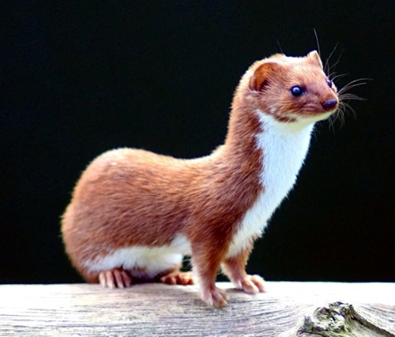

# Dawkins' weasel 🦦

> **Difficulty:** 🌶️🌶️
>
> **Before you start:** basic Python and NumPy, and the optional scientific stack
> (`uv sync --all-groups --extra science`).
>
> **You’ll practise:** random number generators, stochastic simulation, and
> investigating a model by experiment.
>
> **Check:** `uv run pytest exercises/dawkins_weasel/test_weasel.py -m advanced -q`

** Start with 28 random characters. Copy them with the odd typo, keep the best
copy, and repeat. Can a sentence evolve out of gibberish? **

In *The Blind Watchmaker*,
Richard Dawkins used a simple computer model like this to show how cumulative
selection can build something that looks designed. The target here is the
28-character
phrase `METHINKS IT IS LIKE A WEASEL`; each position is chosen from the 26
uppercase letters and a space. Start with a uniformly random phrase. Make a
population of ten copies by independently leaving each character unchanged with
probability 0.99, or mutating it with probability 0.01 to one of the *other*
26 symbols. Score a phrase by the number of positions matching the target,
and choose a highest-scoring copy as the parent of the next generation. Break
ties at random. For reproducibility in this Python version, retain the best
candidate seen so far and inject a NumPy random generator.

A least weasel (*Mustela nivalis*). Photo: [Keven
Law](https://commons.wikimedia.org/wiki/File:Mustela_nivalis_-British_Wildlife_Centre-4.jpg),
[CC BY-SA 2.0](https://creativecommons.org/licenses/by-sa/2.0/), via Wikimedia
Commons, resized.

Implement `matching_characters`, `mutate_message`, and `evolve_weasel` in
[weasel.py](weasel.py). Each generation creates a fixed
number of mutated copies, keeps a highest-scoring candidate, and records the
best score. Then watch it evolve.

Use the [weasel simulation notebook](investigate.ipynb) to
investigate. How many generations does it take to reach the target? Compare
several seeded runs rather than treating one random run as a universal answer,
and ask why they differ. Then try a population of 100, and several mutation
rates. What happens if the mutation rate is very low, or very high? Which is
best, and why?

**Comparison 🚀: evolution versus guessing.** Give a baseline the same budget.
If an evolving run scored `population_size * generations` phrases, generate that
many completely independent random phrases and keep the best score so far. Predict
the outcome first, then plot both best-score-so-far curves against the number of
phrases scored. Which gets closer to the target, and by how much?

> [!NOTE]
> The weasel is a deliberately simplified model. It has a fixed target that
> real evolution never has, a score that rewards each correct letter separately,
> and no changing environment. It shows that selection that *keeps* partial
> progress is far more powerful than chance alone; it does not show that
> evolution is aiming at anything.

How good a model of evolution in nature is this? Consider the known target, the
simple mutation process, and selection based on one fixed score.

## Explaining what you saw 🚀

Two short probability questions explain the results above. Answer them in the
notebook's probability sections, checking each against your simulations.

**How hopeless is random guessing?** How many possible 28-character phrases are
there? If we generated completely random phrases until we found the target, how
long might we expect to wait? Compare your answer with the number of phrases the
weasel scored in the comparison above.

💡 Hint: waiting for a rare event

Each random phrase is an independent attempt that succeeds with probability $p$,
the chance of drawing the one target phrase. The expected number of attempts
until the first success is $1/p$. The answer is far too large to compare by eye,
so use scientific notation or $\log_{10}$. If you could score a billion phrases
a second, how long would that take?

**The last stubborn letter.** Your weasel has evolved 27 of the 28 correct
characters. Surely it's nearly finished?

Calculate the probability that one mutated offspring completes the phrase, and
then the probability that at least one offspring in a generation succeeds. Does
the predicted waiting time agree with your simulations?

💡 Hint 1: what must happen?

For one offspring to match the whole target, something must happen at the one
wrong position *and* something must happen at each of the other 27. Assume the
mutations at different positions are independent. Remember that a mutating
character becomes one of the 26 *other* symbols, only one of which is correct.

💡 Hint 2: the formulae

With mutation rate $\mu$, the wrong position must mutate (probability $\mu$) to
the single correct symbol (probability $1/26$), and each of the other 27
positions must be left alone (probability $1-\mu$ each). So one offspring
succeeds with probability

$$
p = \frac{\mu}{26}(1-\mu)^{27}.
$$

With $n$ offspring, at least one succeeds with probability $q = 1-(1-p)^n$.
If each generation is an independent attempt, the number of generations spent
waiting is geometric, with mean $1/q$.

💡 Hint 3: comparing with simulations, and tiny probabilities

Your `match_history` shows how many generations a run spent with a best score of
27 before reaching 28. Collect this over many seeds and compare the average with
$1/q$. (State your assumptions: for instance, a run may skip 27 altogether.)

Beware that `1 - (1 - p) ** n` rounds to zero when $p$ is tiny;
`-np.expm1(n * np.log1p(-p))` keeps the small positive value.

## The Weasel World Championships 🚀

Three evolutionary strategies are racing to produce the target phrase. Which
will win?

1. **Original weasel:** mutated copies of the single best candidate.
2. **Mutation-only GA:** a population bred by tournament selection and mutation.
3. **Recombination GA:** tournament selection, one-point crossover and mutation.

The original weasel breeds every generation from one winner. Real populations
keep many individuals, some less fit than others, and a genetic algorithm (GA)
does something similar. Implement `fittest`, `tournament_select` and
`evolve_population`, which runs a mutation-only GA on a population of 100:

- **Tournament selection** picks a parent by sampling a few individuals at random
  (three by default) and taking the fittest of them. The best individuals are
  chosen often, but weaker ones sometimes win a tournament too.

Each generation replaces the whole population with new offspring: each is a
mutated copy of a tournament winner, using your `mutate_message` and
`matching_characters`. Start from 100 identical copies of one random phrase,
drawn first from the generator just as the weasel draws its starting phrase, so a
given seed can start every method from the same phrase. Nothing is carried over
unchanged, so unlike the weasel the best score can fall.

> **Check:** `uv run pytest exercises/dawkins_weasel/test_weasel_tournament.py -m advanced -q`

💡 Hint 1: a nudge

Write `fittest` and `tournament_select` first and test them alone. Then build
each generation's offspring one at a time.

💡 Hint 2: a strategy

The loop looks like `evolve_weasel`, but the parent now varies per offspring
and the population (not just a best score) carries from one generation to the next.

Now let the weasels discover sex. **One-point crossover** gives each offspring two
parents: pick a cut position strictly inside the phrase, then join the first part
of one parent to the rest of the other. Implement `one_point_crossover` and switch
it on with `crossover=True` in `evolve_population`. For each offspring, choose two
parents independently by tournament selection, cross them over, and then mutate
the child as before. Use crossover for every offspring.

> **Check:** `uv run pytest exercises/dawkins_weasel/test_weasel_crossover.py -m advanced -q`

💡 Hint: seeing recombination at work

Try crossing `"AAAABBBB"` with `"BBBBAAAA"` and scoring the children against
`"AAAAAAAA"`.

**The race.** Predict the winner before running anything. Then compare the three
strategies across 20 to 30 seeds in the notebook. Does recombination really help?
Does changing the mutation rate affect the winner?

A fair race gives every strategy the same target, population size, mutation rate
and budget of scored phrases (so not each method's defaults), counts generations to
the target, and reports any runs that fail to get there within a generation limit.
Report your results as experimental findings: they depend on the settings and need
not favour any one strategy.
